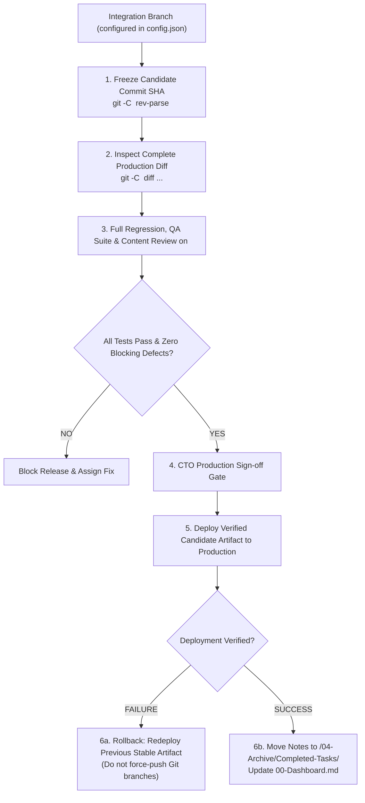

# Workflow Guide: Review, QA Verification & Immutable Release Management

## 0. Gate Depth by Operating Profile

This guide describes the `production` profile. The operating profile in `config.json` sets how much of it applies (normative matrix: [`operating-profiles.md`](./operating-profiles.md) §2):
*   **`production`:** everything below as written: staging, immutable candidate SHA, full suite once per candidate SHA (R3), QA and content verdicts on the same SHA, CTO gate, full rollback plan, hotfix per §3.2.
*   **`pilot`:** no staging required (production with a backup may serve as the test environment); QA covers the fixed defects plus one smoke path per feature, the full suite runs once before the first wide release and then once per candidate SHA that touches shared flows; deploy after the QA smoke and the content verdict, **DB backup first** (Step 5), rollback = restore the backup or redeploy the previous artifact, 15-minute watch; hotfix = commit on integration, deploy, backfill the task note, plus a QA smoke.
*   **`prototype`:** QA is the smoke path of the changed feature; deploy directly from the integration branch after the smoke, **DB backup first**; hotfix = commit on integration, deploy, backfill the task note.

The floors hold in every profile: `delegated_authorities` (a direct deploy still needs `allow_deploy_production` or the user's go-ahead), a verified backup before destructive operations and migrations, no force-push. The reviewer rules and the security review of trigger diffs (§4) also hold in every profile; the profile changes only how much a peer review covers.

---

## 1. The Principle of the Immutable Release Candidate

A software release cannot be approved simply because individual sprint tickets are marked "Ready." Software systems fail at integration boundaries when multiple changes interact unexpectedly.

> [!IMPORTANT]
> **Release Verification Governs the Commit SHA, Not the Sprint Plan**:
> Release verification, QA sign-off, and CTO approval apply strictly to an **immutable commit SHA** (the Release Candidate), representing the **complete production diff** against the production baseline, including any commits pushed outside the sprint plan.



---

## 2. Release Candidate Verification Step-by-Step

All branch names are resolved from `<project_root>/.it-department/config.json`:
*   `$PROD_BRANCH = $config.git_policy.production_branch`
*   `$INT_BRANCH = $config.git_policy.integration_branch`

### Step 1: Identify Repository & Freeze Candidate Commit SHA
Resolve candidate from the target repository and the configured integration ref:
```bash
RELEASE_CANDIDATE_SHA=$(git -C "<repository_root>" rev-parse "$INT_BRANCH")
PRODUCTION_BASELINE_SHA=$(git -C "<repository_root>" rev-parse "$PROD_BRANCH")
echo "Production Baseline SHA: $PRODUCTION_BASELINE_SHA"
echo "Release Candidate SHA:   $RELEASE_CANDIDATE_SHA"
```

### Step 2: Audit Complete Production Diff
Inspect all commits and file diffs between the production baseline and candidate SHA:
```bash
git -C "<repository_root>" log --oneline "$PRODUCTION_BASELINE_SHA..$RELEASE_CANDIDATE_SHA"
git -C "<repository_root>" diff --stat "$PRODUCTION_BASELINE_SHA...$RELEASE_CANDIDATE_SHA"
```
*Audit Check:* Verify that every change in this diff is accounted for. Check for unintended commits or configuration changes. Every commit in the diff that touches a security trigger (§4.3), including commits pushed outside the sprint plan, needs a `PASS` or `PASS-WITH-NOTES` security verdict before the CTO gate; a commit without one goes to the security reviewer first.

### Step 3: Attach Evidence to Candidate SHA
QA test results, security scan outputs, and reviewer approvals are recorded against the exact candidate SHA:
*   `Test Execution: PASS (Candidate: $RELEASE_CANDIDATE_SHA, Tests: 184 passed, 0 failed)`
*   `Defect Audit: PASS (0 Critical, 0 Major defects open)`

QA writes its evidence as `qa-report.md` from [`templates/qa-report.md`](../templates/qa-report.md) (`qa_scope: smoke | targeted | full` per §0) in its session directory; the release-level copy `<vault>/05-Reports/qa-report-<date>-<sha7>.md` is what the dashboard's release table links as "Verified By".

*Efficiency rule R3 (targeted re-verification):* the full regression and scenario suite runs **once per candidate SHA**. After a fix round QA re-verifies only the fixed defects plus one smoke path; a new full run is owed only when the candidate SHA changes (Step 4). Screenshot evidence follows the R2 budget (see [`efficiency-and-usage-audit.md`](./efficiency-and-usage-audit.md)).

### Step 3b: Content & Localization Review of the Candidate (parallel to QA)
The Content Reviewer ([`agents/content-reviewer.md`](../agents/content-reviewer.md)) reviews the same candidate SHA. `scripts/content_inventory.py --root <project_root> --base "$PRODUCTION_BASELINE_SHA"` lists every string added or changed since the baseline, missing or empty keys, placeholder mismatches, wrong writing systems, hardcoded markup text and wrong-language content data; the reviewer reads the texts in every locale, logs content defects as bug notes (`category: content`) and records the verdict against the SHA:
*   `Content Review: APPROVED-WITH-DEFERRALS (Candidate: $RELEASE_CANDIDATE_SHA, locales ru/uz, 0 Critical, 0 Major, 2 Minor deferred by CTO, report vault/05-Reports/content-review-<date>-<sha7>.md)`

A `blocked` verdict (open `Critical`/`Major` content defect) stops the release exactly like a functional blocker; the verdict follows the same invalidation rule as QA evidence (Step 4). Guide: [`content-review.md`](./content-review.md).

### Step 4: The Candidate Invalidation Rule
*   The frozen candidate SHA remains valid for testing even if newer, unrelated commits arrive on `$INT_BRANCH`.
*   **Revalidation is triggered only when:**
    1. The selected release candidate SHA changes (e.g. a bugfix commit is added to the candidate).
    2. The production baseline SHA changes (e.g. an emergency hotfix was deployed).
    3. Build, environment, or dependency inputs affecting the release artifact change.

### Step 5: Production Deployment
Once authorized in accordance with `delegated_authorities` and CTO sign-off (QA verdict **and** content review verdict attached to the same candidate SHA, deferrals signed, a security verdict for every trigger diff in it):
1.  Deploy the built artifact corresponding to `$RELEASE_CANDIDATE_SHA` using the project's deployment mechanism (e.g. CI/CD deploy pipeline, container release).
2.  Update the production branch ref in Git cleanly via fast-forward merge or release tag:
    ```bash
    git -C "<repository_root>" checkout "$PROD_BRANCH"
    git -C "<repository_root>" merge --ff-only "$RELEASE_CANDIDATE_SHA"
    git -C "<repository_root>" tag -a "vX.Y.Z" -m "Release vX.Y.Z (SHA: $RELEASE_CANDIDATE_SHA)"
    ```
3.  Monitor production health and error metrics for 15 minutes post-deployment.

*`pilot` / `prototype` (§0):* the DB backup is taken first and its name (dump file, volume snapshot or export id) is recorded in the session note **before** step 1; the way back is a restore of that backup or a redeploy of the previous artifact.

### Step 6: Post-Deploy Archival
Only **after** deployment success is verified:
1.  The coordinator moves notes from `<vault>/01-Tasks/Ready-For-Release/` to `<vault>/04-Archive/Completed-Tasks/`.
2.  Update task frontmatter:
    ```yaml
    status: Archived
    release_version: "vX.Y.Z"
    release_commit: "$RELEASE_CANDIDATE_SHA"
    archived_at: "2026-09-10T17:30:00Z"
    ```
3.  The coordinator regenerates `<vault>/00-Dashboard.md`.

---

## 3. Non-Destructive Rollback & Hotfix Protocols

### 3.1 Non-Destructive Rollback Procedure
If a production deployment fails or causes severe regressions:

> [!CAUTION]
> **Never Force-Push or Hard-Reset Git Branches During an Outage**:
> Changing a git branch pointer does not roll back a live deployment and destroys shared history.

1.  **Operational Artifact Rollback:**
    *   Immediately re-deploy the previous known healthy artifact / container / package tag through the project's deployment system.
2.  **Database Migration Compatibility:**
    *   Do **not** assume rolling back the application container undoes database migrations.
    *   If the migration was backwards-compatible, leave it in place.
    *   If the migration caused the failure, execute the task's pre-planned database mitigation script or prepare a forward fix.
3.  **Source Code Synchronization:**
    *   After the live deployment is stabilized, correct the repository history non-destructively by opening a revert pull request:
    ```bash
    git -C "<repository_root>" revert -m 1 "$RELEASE_CANDIDATE_SHA"
    ```
    *   Merge the revert PR through the normal protected review process.
4.  **Escalation when Rollback is Unsupported:**
    *   If the project has no automated rollback mechanism, the coordinator immediately records a blocker note and escalates to the CTO and human user with a concrete incident summary.

### 3.2 Emergency Production Hotfix Flow
This is the `production` hotfix; `prototype` and `pilot` use the short form in §0. When a critical vulnerability or production crash requires an immediate patch:
1.  **Worktree from Production:**
    ```bash
    git -C "<repository_root>" worktree add -b "hotfix/{task-id}/{dd.mm.yyyy}/dev-backend" \
      "<project_root>/.it-department/worktrees/{task-id}" "$PROD_BRANCH"
    ```
2.  **Implement & Verify:** Write minimal patch in the worktree. Run pre-deploy tests. A patch that touches a security trigger gets the security review before the deploy; when the CTO rules that the outage cannot wait, the review runs right after it, the hotfix is not reported done until the verdict, and a `BLOCK` reopens it as a `Critical` bug (§4.3).
3.  **Deploy Hotfix:** Deploy verified artifact and fast-forward `$PROD_BRANCH`.
4.  **Mandatory Synchronization Back to Integration:**
    *   To prevent regression in the next regular release, the hotfix commit must be synchronized back into `$INT_BRANCH` via a standard pull request:
    ```bash
    git -C "<repository_root>" checkout "$INT_BRANCH"
    git -C "<repository_root>" merge "$PROD_BRANCH"
    ```

---

## 4. Reviewers: Delegation Matrix & Rules

A reviewer nobody dispatches protects nothing. The matrix says, for each kind of change, which reviewer is mandatory and by when; the coordinator reads it literally at every hand-off and names the dispatched reviewers in the brief ([`orchestration-and-worktrees.md`](./orchestration-and-worktrees.md) §2).

### 4.1 Delegation matrix

| Reviewer | Mandatory when | Verdict due before | Verdict | Evidence |
| :--- | :--- | :--- | :--- | :--- |
| **Peer code reviewer** (another developer or the architect; the coordinator only where the profile allows a diff read) | `production`: every diff; `pilot`: full-route tasks; otherwise the coordinator reads the diff | the task is reported done (`Code-Review → QA-Testing`) | `approved` / `changes-requested` | `code-review.md` |
| **Security reviewer** ([`agents/security-reviewer.md`](../agents/security-reviewer.md)) | the diff touches a trigger (§4.3), in **every** profile and on every route: pull request, direct commit, hotfix, config change on a server | the task is reported done; for a candidate, the CTO gate | `PASS` / `PASS-WITH-NOTES` / `BLOCK` | `security-review.md` |
| **Architect** ([`agents/architect.md`](../agents/architect.md)) | `pilot`: schema, auth, payments, integrations; `production`: every non-trivial trade-off; any new or changed ADR | `Ready-For-Dev` | ADR `Accepted` / `Rejected` | ADR note |
| **QA engineer** ([`agents/qa-engineer.md`](../agents/qa-engineer.md)) | every task and bug fix past `Code-Review`, at the profile's scope (§0) | `Ready-For-Release` / `Closed` | `passed` / `passed-with-deferrals` / `failed` | `qa-report.md` |
| **Content reviewer** ([`agents/content-reviewer.md`](../agents/content-reviewer.md)) | `content_review: required` (Checkpoint A); every release candidate (Checkpoint B) | `Ready-For-Dev`; the CTO gate | `approved` / `approved-with-deferrals` / `blocked` | `content-review-*.md` |

Several rows often apply at once: a new table behind an admin screen that also sends a webhook needs the architect, the peer reviewer, the security reviewer (`schema`, `auth`, `outbound-http`), QA and the content reviewer. Reviewers that look at the same SHA run in parallel.

### 4.2 Reviewer rules (every reviewer, every profile)

1.  **Before the task is reported done, not before merge.** The duty is tied to the moment anyone says "done" (a developer's hand-off, the coordinator's transition, the "Done" list of a hand-off note, a report to the CTO), not to a merge that may happen later, somewhere else or never. A change that is never merged through a pull request (a hotfix, a direct commit in `prototype`, a config change on a server) still needs its reviewers.
2.  **The author never reviews its own work.** Whoever wrote any part of the diff, including a coordinator that patched code itself, is not its reviewer. In sequential mode ([`orchestration-and-worktrees.md`](./orchestration-and-worktrees.md) §1) the review runs in a fresh session that never saw the authoring context; when that is impossible the coordinator records `review: not independent` and the CTO decides. It never presents its own reading as an independent review.
3.  **Reviewers are read-only.** A reviewer reads, runs targeted checks and writes its own report and session directory (QA, content and security reviewers may also open bug notes). It never edits, commits or pushes the code it reviews; the author applies the findings. A reviewer that fixes what it reviews has become an author, and its verdict no longer counts.
4.  **Verify against the code, never against the PR or the task text.** The verdict rests on the files at the reviewed SHA, their callers and the config they read. The PR body, commit messages, the task note and the developer's hand-off say where to look; they are never the evidence. A symbol is checked at the definition the call site imports, not at a same-named one elsewhere.
5.  **A blocking verdict is never downgraded.** A security `BLOCK`, a `changes-requested` review on a defect, or a QA or content `Critical`/`Major` finding stops the task until it is fixed and reviewed again. Nobody rewrites it as a note, a follow-up task or a "known limitation" to move on. The single exception is the user's Stubborn Donkey override with an `ADR-OVERRIDE` that names the finding ([`deep-reasoning-and-override.md`](./deep-reasoning-and-override.md)); it does not exist for a floor ([`operating-profiles.md`](./operating-profiles.md) §3).

### 4.3 Security review: triggers, dispatch, timing

The trigger ids are `auth`, `schema`, `pii-logging`, `outbound-http`, `rate-limits`, `forwarded-headers`, `secrets-config`, `payments` and `file-upload`; what each covers is in [`agents/security-reviewer.md`](../agents/security-reviewer.md) §2 and its checklist in §4.

1.  **Detect.** The developer's `handoff.md` names the triggers its diff touches, or `none`. The coordinator does not take that on trust: it matches the changed files against `security_review.trigger_paths` in `config.json` and reads the diff for behaviour no glob catches (a new log line with an email, a new outbound call):
    ```bash
    git -C "<repository_root>" diff --name-only "<base>...<head_sha>"
    git -C "<repository_root>" diff --name-only "<base>...<head_sha>" -- ':(glob)**/migrations/**' ':(glob)**/.env*'   # globs from trigger_paths
    ```
2.  **Dispatch** the security reviewer with the repository, base, head SHA, the triggers found and the task card, in parallel with the peer reviewer.
3.  **Timing per route:** pull request: between the developer's hand-off and `Code-Review → QA-Testing`; coordinator diff read (`prototype`, lightweight `pilot`): before the change is reported done; hotfix: before the deploy, or right after it when the CTO rules that the outage cannot wait (§3.2); release candidate: every trigger commit of the production diff has a verdict before the CTO gate (§2, Step 2).
4.  **Verdict.** `PASS` and `PASS-WITH-NOTES` let the task continue; the coordinator files each note as a backlog task or a `Minor`/`Trivial` bug. `BLOCK` sends the task back to `In-Development` through the reviewer's transition request, and rule 5 applies. The verdict names the head SHA: later commits that touch a trigger need a review of the delta.
5.  **Depth by profile.** The trigger list, the independence rule and the verdict are the same in every profile. In `prototype` the report may be just the checklist rows of the touched triggers and the findings.
